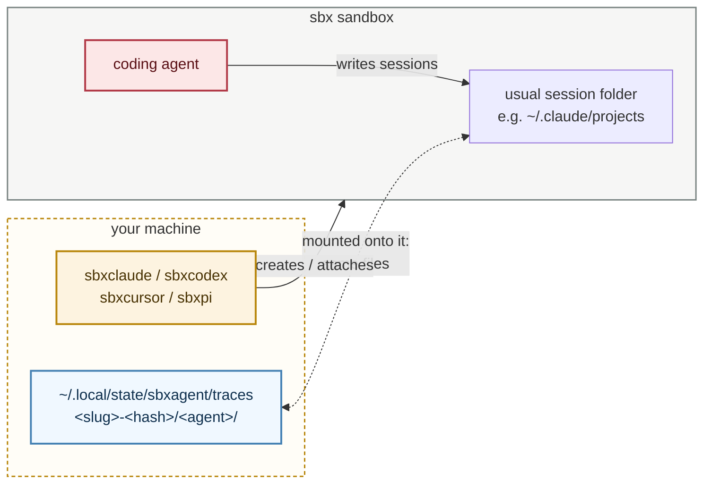

# Session traces

Where each agent's session trace ends up, and who else can read it. See
[toolchain.md](toolchain.md) for the state folder these paths sit in.

## Contents

- [How traces reach the host](#how-traces-reach-the-host)
- [Where the traces live](#where-the-traces-live)
- [Trace formats](#trace-formats)
- [Cross-sandbox visibility](#cross-sandbox-visibility)
- [Retention and exceptions](#retention-and-exceptions)
- [Under the hood](#under-the-hood)

## How traces reach the host

Each agent saves its sessions where it always does, inside the sandbox. The
wrapper makes that folder and a folder on your machine the same folder. The
host folder is `~/.local/state/sbxagent/traces/<slug>-<hash>/<agent>/`, for example
`…/sbxclaude/`.

So when the agent saves a session, the file is on your machine at once. Nothing
copies or syncs it later.

The wrapper mounts the host folder straight onto the agent's own session
folder when it creates the sandbox. Think of it as one folder with two doors.
`sbx` keeps that mount for the life of the sandbox, across stops and
restarts, and nothing inside the sandbox has to run for it.

<!-- cspell:disable -->



<!-- cspell:enable -->

<br>*The wrapper (amber) creates the sandbox and mounts the host state folder
(blue) onto the agent's usual session path. The agent (red) keeps writing
there, and the files show up on the host. See
[Under the hood](#under-the-hood) for the details.*

## Where the traces live

Everything sits under one folder in your home directory:

```text
~/.local/state/sbxagent/traces/<slug>-<hash>/<agent>/
```

- `<slug>` is the name of your project folder. Anything that is not a letter,
  digit or dash becomes a dash.
- `<hash>` is the first 8 characters of a SHA-256 of the project's full path.
  Two projects with the same folder name still get different state folders.
- `<agent>` is the wrapper you ran: `sbxclaude`, `sbxcodex`, `sbxcursor` or
  `sbxpi`.

Say your project is `~/Code/weather-app` and you have used all four agents on
it. Your home folder then looks like this:

```text
~
├── Code
│   └── weather-app                      ← your project
└── .local
    └── state
        └── sbxagent
            └── traces
                └── weather-app-3f9a1c2e     ← <slug>-<hash>
                    ├── sbxclaude
                    │   └── projects
                    │       └── -Users-you-Code-weather-app
                    │           └── 8c1d2e7a-….jsonl
                    ├── sbxcodex
                    │   └── sessions
                    │       └── 2026
                    │           └── 09
                    │               └── 13
                    │                   └── rollout-2026-09-13T10-42-07-….jsonl
                    ├── sbxcursor
                    │   └── projects
                    │       └── Users-you-Code-weather-app
                    │           └── agent-transcripts
                    │               └── 5b7e…
                    │                   └── 5b7e….jsonl
                    └── sbxpi
                        └── sessions
                            └── --Users-you-Code-weather-app--
                                └── 2026-09-13T10-42-07_….jsonl
```

You do not have to work any of that out. In your project, run `sbxclaude name`
(or the matching command for the other agents). It prints
`sbxclaude-<slug>-<hash>`. Drop the `sbxclaude-` prefix and you have the folder:

```bash
cd ~/.local/state/sbxagent/traces/"$(sbxclaude name | sed 's/^sbxclaude-//')"/sbxclaude
```

If you set `XDG_STATE_HOME` to an absolute path, the tree lives under
`$XDG_STATE_HOME/sbxagent/traces/` instead of `~/.local/state/sbxagent/traces/`.

The wrapper keeps each agent's native session format and relocates its trace
tree into that agent's state subfolder:

| Agent | Stock path in the sandbox | Path below the agent state folder |
| --- | --- | --- |
| Claude Code | `~/.claude/projects` | `projects/` |
| Codex | `~/.codex/sessions` | `sessions/` |
| Cursor | `~/.cursor/projects` | `projects/` |
| Pi | `~/.pi/agent/sessions` | `sessions/` |

## Trace formats

Each agent owns its own on-disk format; the wrapper only keeps those files on
the host. Layouts can change with agent releases. Roughly, under each agent's
state subfolder:

| Agent | Typical path under the agent state folder | What you find |
| --- | --- | --- |
| Claude Code | `projects/-<escaped-cwd>/<session-uuid>.jsonl` | One JSONL file per session; each line is a typed event (`user`, `assistant`, and similar) |
| Codex | `sessions/<YYYY>/<MM>/<DD>/rollout-<timestamp>-<id>.jsonl` | Date-bucketed “rollout” JSONL files |
| Cursor | `projects/<escaped-cwd>/agent-transcripts/<id>/<id>.jsonl` | Per-chat transcript JSONL (`role` user/assistant). Other project files (for example `mcp-approvals.json`) may sit alongside |
| Pi | `sessions/--<escaped-cwd>--/<timestamp>_<id>.jsonl` | One JSONL per session; a `session` header line, then messages and events |

## Cross-sandbox visibility

With the default `CROSS_SANDBOX_VISIBILITY=true`, sibling agents for the same
project can read these complete traces, including prompts, tool output, file
excerpts, and any secrets recorded in them. Set
`CROSS_SANDBOX_VISIBILITY=false` before creating a sandbox to hide sibling
state. This setting, and the trace mount itself, are fixed at sandbox creation
time; remove and rebuild existing sandboxes after changing the setting.

## Retention and exceptions

Claude Code applies its normal `cleanupPeriodDays` retention setting (30 days
by default) to these host-backed transcripts. Cursor's SQLite resume store
remains inside its sandbox to avoid database locking on the shared mount.
Cursor also keeps per-project files in the same tree — the workspace trust
marker and `mcp-approvals.json` — so those land on the host too. A kit started
directly with `sbx run`, without the wrapper, keeps its stock trace location.

## Under the hood

For readers who want the details. The rest of this page does not depend on
them.

### The wrapper's side

`scripts/sbxagent` works out the per-agent state folder (`AGENT_DIR`), creates
it with mode `0700`, creates the trace subfolder inside it, and hands it to
`sbx` as an extra workspace in `PATH:TARGET` form:

```bash
sbx create --name "${SANDBOX}" --kit "${KIT}" claude . \
  "${AGENT_DIR}/projects:/home/agent/.claude/projects"
```

The other agents follow the table in [Where the traces live](#where-the-traces-live).
The project-wide state folder is mounted read-only beside it, so sibling
traces are readable but not writable.

### What `sbx` does with it

- **At create.** The mount is in place before any kit hook runs, so traces
  already on the host — from an older sandbox, say — are visible at once.
- **Across stops.** The mount is part of the sandbox's recorded setup, so it is
  back on every start, including `sbx<agent> exec` sessions that never launch
  the agent.
- **If the host folder is gone.** `sbx` refuses to start the sandbox, with
  `workspace directory "…" no longer exists on the host`. Restore the folder,
  or remove the sandbox. A fresh `sbx<agent> create` makes it again.

`tests/lifecycle_test.sh` (`make test-lifecycle AGENT=<agent>`) checks each of
these from the host.

### Directory ownership

When the agent's config folder does not exist yet, creating the mount makes
it, owned by root. Docker's `claude`, `cursor` and `pi` workloads hand their
folder back to the agent in an install hook. The `codex` workload has no such
hook, so `sbxcodex` ships `~/.codex` in its own layer, owned by the agent.
